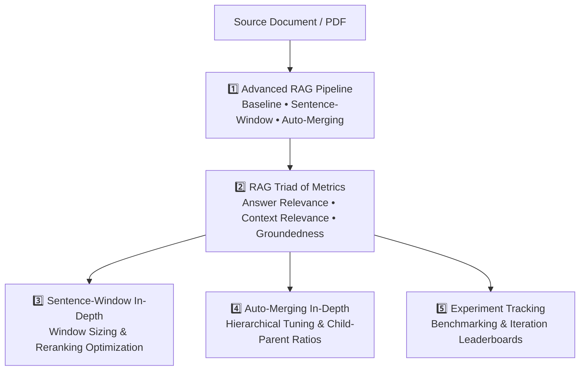
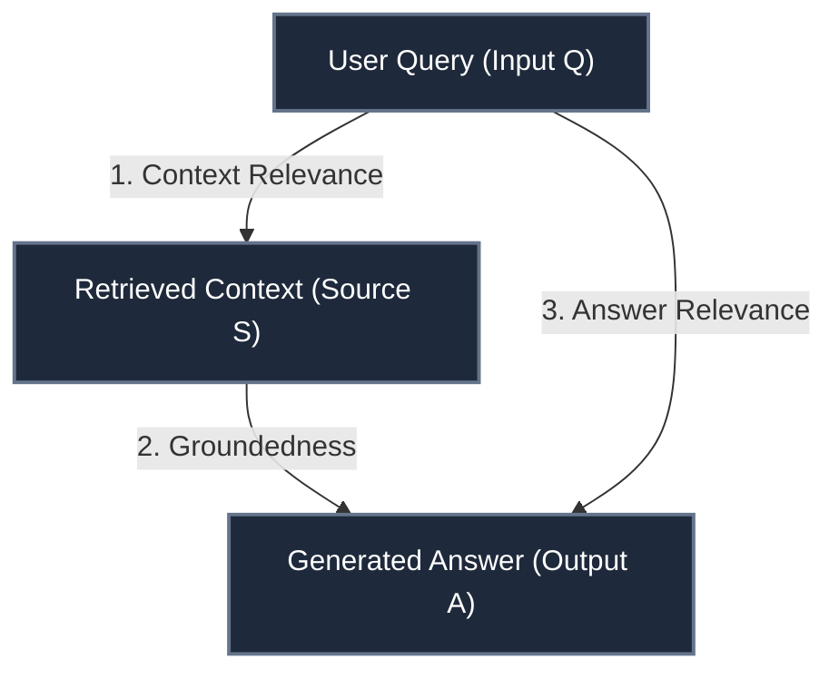

# Advanced RAG in Go — Course Guide

> [!NOTE]
> This is a living document. Each lesson adds a new section with concepts, Go code, and comparison notes vs the Python original.

---

## Course Map



---

## Lesson 1 — Advanced RAG Pipeline

In Lesson 1, we implemented the complete RAG architectural patterns:
1. **Baseline RAG**: Standard chunking + top-k vector similarity search (`Direct Query Engine`).
2. **Sentence-Window Retrieval**: Decoupling search granularity from context generation (`Sentence Window Query Engine`).
3. **Auto-Merging Retrieval**: Multi-tier hierarchical indexing with dynamic child-to-parent consolidation (`Automerging Query Engine`).

---

## Lesson 2 — RAG Triad of Metrics & Chain-of-Thought Evaluation

In Lesson 2, the course transitions from *building* to *evaluating and debugging* RAG systems.

Without rigorous evaluation, you cannot know if your RAG pipeline failed because:
- The retriever retrieved irrelevant junk.
- The LLM hallucinated despite good context.
- The LLM gave a truthful answer to the wrong question.

The **RAG Triad** isolates each step of the RAG loop into an independent feedback metric:



---

### The Three Feedback Functions In-Depth

#### 1. Answer Relevance ($Q \longrightarrow A$)
- **Question**: Does the answer directly address the user's question?
- **Python**:
  ```python
  f_qa_relevance = Feedback(provider.relevance_with_cot_reasons, name="Answer Relevance").on_input_output()
  ```
- **Go**: [`evaluator.ScoreAnswerRelevance(ctx, question, answer)`](file:///Users/vikash/projects/rag_project/internal/eval/eval.go)
- **Why it matters**: A response can be 100% grounded in the context, but if the user asked *"What is the salary of an ML engineer?"* and the bot replied *"An ML engineer trains neural networks in Python,"* the answer relevance is zero.
- **Chain of Thought (CoT)**: Returns a score $\in [0.0, 1.0]$ and an explicit rationale explaining whether any part of the question was skipped or answered evasively.

---

#### 2. Context Relevance ($Q \longrightarrow S$)
- **Question**: Is the retrieved context actually relevant and free of irrelevant noise?
- **Python**:
  ```python
  f_qs_relevance = (
      Feedback(provider.qs_relevance_with_cot_reasons, name="Context Relevance")
      .on_input()
      .on(TruLlama.select_source_nodes().node.text)
      .aggregate(np.mean)
  )
  ```
- **Go**: [`evaluator.ScoreContextRelevance(ctx, question, retrievedContext)`](file:///Users/vikash/projects/rag_project/internal/eval/eval.go)
- **Why it matters**: If retrieval returns irrelevant documents, the context window fills with distraction ("lost in the middle" problem), causing slower generation, higher API cost, and hallucination.
- **Aggregation**: Scores each retrieved chunk and computes the mean relevance score across all retrieved source nodes ($\frac{1}{N} \sum_{i=1}^N \text{rel}(Q, S_i)$).

---

#### 3. Groundedness ($S \longrightarrow A$)
- **Question**: Is every factual claim in the answer supported by the retrieved context?
- **Python**:
  ```python
  grounded = Groundedness(groundedness_provider=provider)
  f_groundedness = (
      Feedback(grounded.groundedness_measure_with_cot_reasons, name="Groundedness")
      .on(context_selection)
      .on_output()
      .aggregate(grounded.grounded_statements_aggregator)
  )
  ```
- **Go**: [`evaluator.ScoreGroundedness(ctx, retrievedContext, answer)`](file:///Users/vikash/projects/rag_project/internal/eval/eval.go)
- **Algorithm (Statement-by-Statement Verification)**:
  1. Break the answer down into atomic factual statements: $A \rightarrow \{s_1, s_2, \dots, s_m\}$.
  2. For each statement $s_j$, verify if it can be directly inferred from the retrieved context $S$.
  3. Aggregate the score as the ratio of supported statements:
     $$\text{Groundedness} = \frac{\text{Count}(\text{Supported})}{\text{Total Statements}}$$
  4. Output Chain-of-Thought reasons documenting which statements passed and which failed verification.

---

### Python vs Go Evaluation Mapping

| TruLens (Python) | Go Implementation | Rationale |
|---|---|---|
| `provider = fOpenAI()` | `internal/eval/eval.go` (`judgeJSON`) | Uses LLM-as-judge with JSON schema enforcement |
| `Feedback(...).on_input_output()` | `evaluator.ScoreAnswerRelevance()` | Direct functional evaluation |
| `Feedback(...).aggregate(np.mean)` | `evaluator.ScoreContextRelevance()` | Averages node scores |
| `grounded.grounded_statements_aggregator` | `evaluator.ScoreGroundedness()` | Extracts atomic claims and computes supported ratio |
| `records, feedback = tru.get_records_and_feedback()` | `evaluator.Records()` | Structured slice of `Record` structs |
| `records[["input", "output"] + feedback]` | `eval.PrintRecordsDetail()` | Formatted CLI printout showing inputs, outputs & CoT |
| `tru.get_leaderboard(app_ids=[])` | `eval.PrintLeaderboard()` | Multi-pipeline comparative table |
| `tru.run_dashboard()` (`:8501`) | `eval.StartDashboard("127.0.0.1:8501")` | Embedded zero-dependency HTTP server on port 8501 |

---

## Running the Code

### 1. Run Lesson 2 Mode (App_1 with Sentence-Window & CoT Evaluation)
```bash
go run ./cmd/rag -mode=lesson2
```

### 2. Run Lesson 2 and Launch the Web Dashboard (`http://localhost:8501/`)
```bash
go run ./cmd/rag -mode=lesson2 -dashboard
```

### 3. Run All Pipelines (Comparative Leaderboard)
```bash
go run ./cmd/rag -mode=all
```

### 4. Run Tests
```bash
go test -v ./...
```
