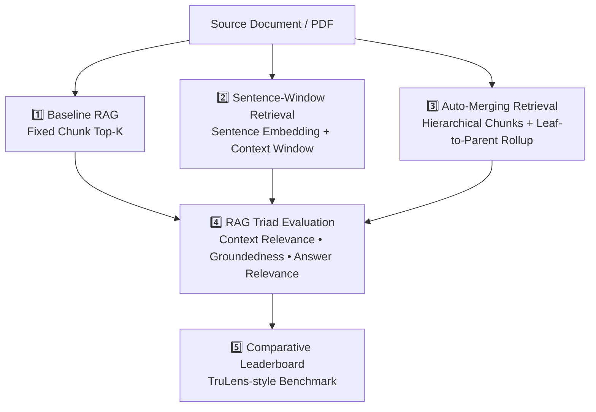
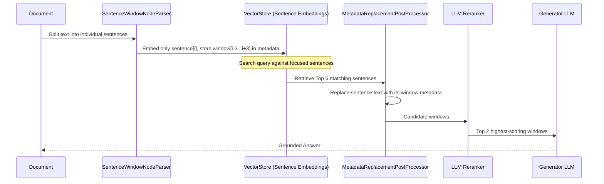
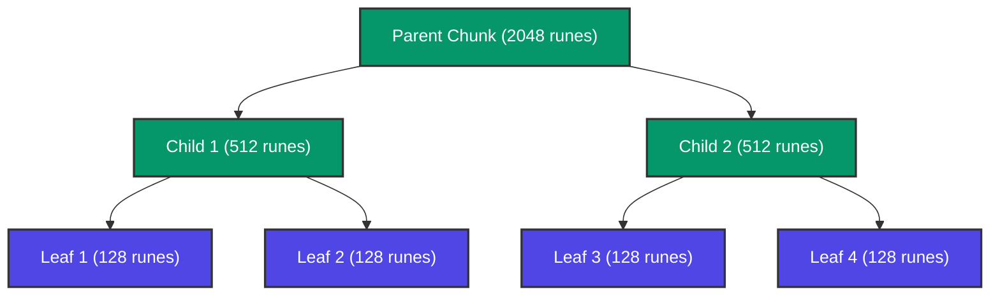

# Advanced RAG in Go — Course Guide

> [!NOTE]
> This is a living document. Each lesson adds a new section with concepts, Go code, and comparison notes vs the Python original.

---

## Course Map



---

## Lesson 1 — Advanced RAG Pipeline

In Lesson 1, we implement the complete RAG spectrum introduced in the course:
1. **Baseline RAG**: Standard chunking + top-k vector similarity search.
2. **Sentence-Window Retrieval**: Decoupling the text used for search from the text sent to the LLM.
3. **Auto-Merging Retrieval**: Multi-tier hierarchical indexing with dynamic child-to-parent merging.
4. **TruLens RAG Triad**: Evaluation framework using LLM-as-judge.

---

### 1. Baseline RAG (`Direct Query Engine`)

```
Document ──► Fixed Chunks (1024) ──► Embeddings ──► Vector Store
                                                           │
Query ──► Embed ──► Cosine Similarity (Top 6) ─────────────┘
                         │
                         ▼
             LLM Prompt (Context + Question) ──► Answer
```

- **Problem with Baseline**:
  - If chunks are too small: retrieval is precise, but the LLM lacks sufficient surrounding context to answer thoroughly.
  - If chunks are too large: retrieval quality degrades due to semantic noise (topic drift inside a big chunk).

---

### 2. Sentence-Window Retrieval (`Sentence Window Query Engine`)



- **Core Insight**: **Decouple the embedding representation from the generation context.**
- Embed single sentences for razor-sharp semantic matching.
- Expand each hit with its surrounding window of $N$ sentences (default: 3 before and 3 after) before passing to the LLM.
- Filter with a cross-encoder / LLM reranker to select the top 2 richest windows.

---

### 3. Auto-Merging Retrieval (`Automerging Query Engine`)



- **Storage Setup**:
  - `DocStore`: Holds all nodes at every level (2048, 512, 128 runes).
  - `VectorStore`: Only stores and indexes the **smallest leaf nodes** (128 runes).
- **Retrieval & Auto-Merging Algorithm**:
  1. Retrieve top-12 leaf chunks by cosine similarity.
  2. For every parent, count how many of its children were retrieved.
  3. If $\ge 50\%$ (threshold) of a parent's children are retrieved, **evict the children and replace them with the parent node**!
  4. Continue merging recursively up the tree if grandparent conditions are met.
  5. Rerank the final consolidated chunks to top-2 and feed to the generator LLM.

---

### 4. The RAG Triad Evaluation (TruLens Equivalent)

| Metric | Question it Answers | TruLens Implementation | Our Go Implementation |
|---|---|---|---|
| **Context Relevance** | Is the retrieved passage relevant to the question? | `Feedback(openai.relevance_with_cot_reasons).on_input().on(nodes)` | `evaluator.scoreContextRelevance()` |
| **Groundedness** | Are the facts in the answer supported by the retrieved context? | `Groundedness(groundedness_provider=openai).on(nodes).on_output()` | `evaluator.scoreGroundedness()` |
| **Answer Relevance** | Does the answer directly address the user's inquiry? | `Feedback(openai.relevance_with_cot_reasons).on_input_output()` | `evaluator.scoreAnswerRelevance()` |

---

## Python vs Go Mapping

| Python Concept / Class | Go Package & Type | Notes |
|---|---|---|
| `SimpleDirectoryReader` | `loader.LoadPDF()` | Reads PDF pages, preserves page metadata |
| `Document` | `loader.Document` | `ID`, `Text`, `Metadata` |
| `SentenceWindowNodeParser` | `loader.BuildSentenceWindows()` | Extracts sentences and builds surrounding window |
| `HierarchicalNodeParser` | `loader.BuildHierarchy()` | Multi-level tree with `ParentID` and `ChildIDs` |
| `VectorStoreIndex` | `vectorstore.InMemoryStore` | Thread-safe in-memory cosine store |
| `StorageContext.docstore` | `vectorstore.InMemoryDocStore` | Key-value store for tree nodes |
| `SentenceTransformerRerank` | `retriever.NewLLMReranker()` | Cross-attention scoring using LLM |
| `AutoMergingRetriever` | `retriever.NewAutoMerging()` | Threshold-based child eviction and parent replacement |
| `Tru` & `TruLlama` | `eval.Evaluator` & `eval.PrintLeaderboard` | LLM-as-judge scoring + formatted comparison table |

---

## Running the Code

### 1. Set your OpenAI API Key
```bash
cp .env.example .env
# Edit .env with your key:
OPENAI_API_KEY=sk-...
```

### 2. Run All 3 Pipelines with Comparative Leaderboard
```bash
go run ./cmd/rag -mode=all
```

### 3. Run a Specific Pipeline
```bash
# Baseline only
go run ./cmd/rag -mode=baseline

# Sentence-window only
go run ./cmd/rag -mode=sentence

# Auto-merging only
go run ./cmd/rag -mode=automerging
```

### 4. Run Unit Tests
```bash
go test -v ./...
```
