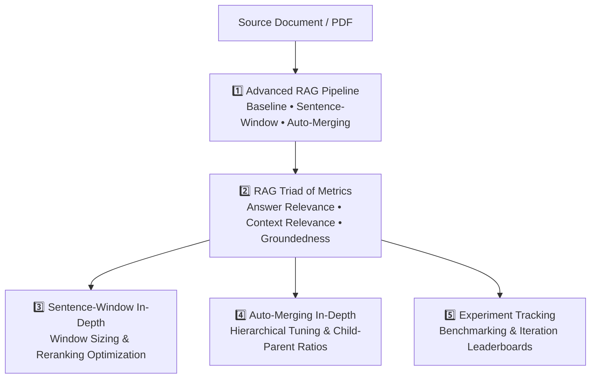
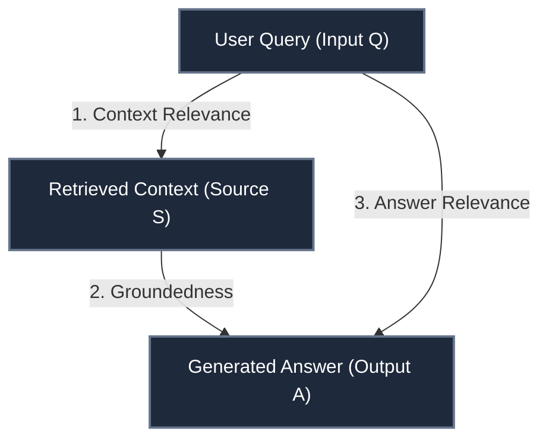
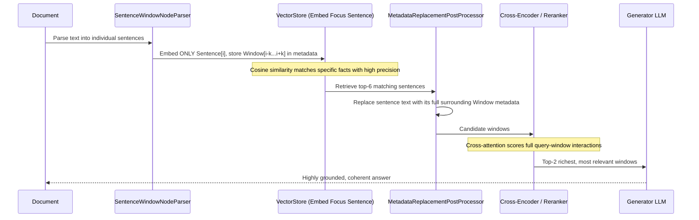
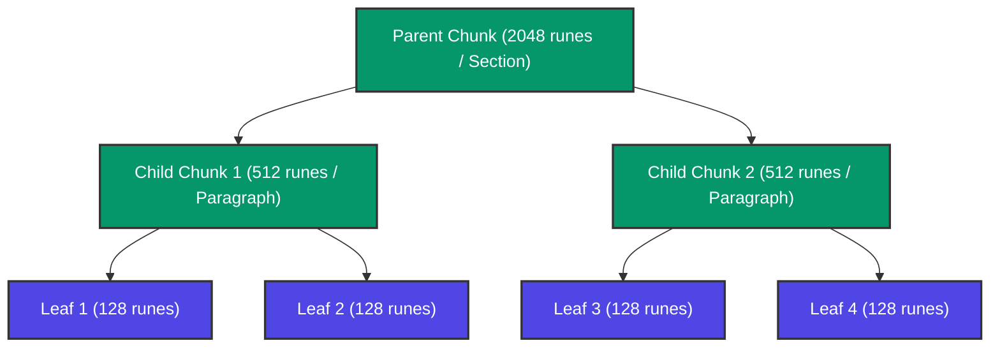

# Advanced RAG in Go — Course Guide

> [!NOTE]
> This is a living document. Each lesson adds a new section with concepts, Go code, and comparison notes vs the Python original.

---

## Course Map



---

## Lesson 1 — Advanced RAG Pipeline

In Lesson 1, we implemented the complete RAG architectural patterns:
1. **Baseline RAG**: Standard chunking + top-k vector similarity search (`Direct Query Engine`).
2. **Sentence-Window Retrieval**: Decoupling search granularity from context generation (`Sentence Window Query Engine`).
3. **Auto-Merging Retrieval**: Multi-tier hierarchical indexing with dynamic child-to-parent consolidation (`Automerging Query Engine`).

---

## Lesson 2 — RAG Triad of Metrics & Chain-of-Thought Evaluation

In Lesson 2, the course transitions from *building* to *evaluating and debugging* RAG systems.

Without rigorous evaluation, you cannot know if your RAG pipeline failed because:
- The retriever retrieved irrelevant junk.
- The LLM hallucinated despite good context.
- The LLM gave a truthful answer to the wrong question.

The **RAG Triad** isolates each step of the RAG loop into an independent feedback metric:



---

### The Three Feedback Functions In-Depth

#### 1. Answer Relevance ($Q \longrightarrow A$)
- **Question**: Does the answer directly address the user's question?
- **Python**:
  ```python
  f_qa_relevance = Feedback(provider.relevance_with_cot_reasons, name="Answer Relevance").on_input_output()
  ```
- **Go**: [`evaluator.ScoreAnswerRelevance(ctx, question, answer)`](file:///Users/vikash/projects/rag_project/internal/eval/eval.go)
- **Why it matters**: A response can be 100% grounded in the context, but if the user asked *"What is the salary of an ML engineer?"* and the bot replied *"An ML engineer trains neural networks in Python,"* the answer relevance is zero.
- **Chain of Thought (CoT)**: Returns a score $\in [0.0, 1.0]$ and an explicit rationale explaining whether any part of the question was skipped or answered evasively.

---

#### 2. Context Relevance ($Q \longrightarrow S$)
- **Question**: Is the retrieved context actually relevant and free of irrelevant noise?
- **Python**:
  ```python
  f_qs_relevance = (
      Feedback(provider.qs_relevance_with_cot_reasons, name="Context Relevance")
      .on_input()
      .on(TruLlama.select_source_nodes().node.text)
      .aggregate(np.mean)
  )
  ```
- **Go**: [`evaluator.ScoreContextRelevance(ctx, question, retrievedContext)`](file:///Users/vikash/projects/rag_project/internal/eval/eval.go)
- **Why it matters**: If retrieval returns irrelevant documents, the context window fills with distraction ("lost in the middle" problem), causing slower generation, higher API cost, and hallucination.
- **Aggregation**: Scores each retrieved chunk and computes the mean relevance score across all retrieved source nodes ($\frac{1}{N} \sum_{i=1}^N \text{rel}(Q, S_i)$).

---

#### 3. Groundedness ($S \longrightarrow A$)
- **Question**: Is every factual claim in the answer supported by the retrieved context?
- **Python**:
  ```python
  grounded = Groundedness(groundedness_provider=provider)
  f_groundedness = (
      Feedback(grounded.groundedness_measure_with_cot_reasons, name="Groundedness")
      .on(context_selection)
      .on_output()
      .aggregate(grounded.grounded_statements_aggregator)
  )
  ```
- **Go**: [`evaluator.ScoreGroundedness(ctx, retrievedContext, answer)`](file:///Users/vikash/projects/rag_project/internal/eval/eval.go)
- **Algorithm (Statement-by-Statement Verification)**:
  1. Break the answer down into atomic factual statements: $A \rightarrow \{s_1, s_2, \dots, s_m\}$.
  2. For each statement $s_j$, verify if it can be directly inferred from the retrieved context $S$.
  3. Aggregate the score as the ratio of supported statements:
     $$\text{Groundedness} = \frac{\text{Count}(\text{Supported})}{\text{Total Statements}}$$
  4. Output Chain-of-Thought reasons documenting which statements passed and which failed verification.

---

### Python vs Go Evaluation Mapping

| TruLens (Python) | Go Implementation | Rationale |
|---|---|---|
| `provider = fOpenAI()` | `internal/eval/eval.go` (`judgeJSON`) | Uses LLM-as-judge with JSON schema enforcement |
| `Feedback(...).on_input_output()` | `evaluator.ScoreAnswerRelevance()` | Direct functional evaluation |
| `Feedback(...).aggregate(np.mean)` | `evaluator.ScoreContextRelevance()` | Averages node scores |
| `grounded.grounded_statements_aggregator` | `evaluator.ScoreGroundedness()` | Extracts atomic claims and computes supported ratio |
| `records, feedback = tru.get_records_and_feedback()` | `evaluator.Records()` | Structured slice of `Record` structs |
| `records[["input", "output"] + feedback]` | `eval.PrintRecordsDetail()` | Formatted CLI printout showing inputs, outputs & CoT |
| `tru.get_leaderboard(app_ids=[])` | `eval.PrintLeaderboard()` | Multi-pipeline comparative table |
| `tru.run_dashboard()` (`:8501`) | `eval.StartDashboard("127.0.0.1:8501")` | Embedded zero-dependency HTTP server on port 8501 |

---

## Lesson 3 — Sentence Window Retrieval In-Depth

In Lesson 3, we dive deep into **Sentence-Window Retrieval** to understand its mechanics, why it outperforms baseline RAG, and how to systematically tune its hyperparameters using TruLens.

---

### The Fundamental Dilemma of Baseline Chunking

In standard RAG, you pick a fixed chunk size (e.g. 512 or 1024 tokens) and use the exact same chunk for **both retrieval and synthesis**:

```
[Chunk Text] ──► Embedded for Search ──► Passed to LLM for Generation
```

This creates an unavoidable trade-off:
- **Small Chunks (e.g. 100 tokens)**: Great retrieval precision (clean semantic vectors with zero topic drift), but the LLM gets fragmented text and hallucinates because of **context starvation**.
- **Large Chunks (e.g. 1024 tokens)**: Rich generation context, but terrible retrieval precision because the embedding averages multiple distinct topics (**semantic noise**), dropping context relevance.

**Sentence-Window Retrieval solves this by completely decoupling retrieval granularity from generation granularity.**



---

### The Four Pillars of the Sentence Window Architecture

#### 1. Sentence Window Node Parser
- Takes source documents and segments text into individual sentence nodes.
- For each sentence at index $i$:
  - `Text`: Sentence $i$ (the focus sentence used for embeddings).
  - `Metadata["original_text"]`: Sentence $i$.
  - `Metadata["window"]`: Sentence sequence $[i - \text{window\_size}, \dots, i, \dots, i + \text{window\_size}]$.
- **Go implementation**: [`loader.BuildSentenceWindows()`](file:///Users/vikash/projects/rag_project/internal/loader/sentence.go)

#### 2. Index Persistence & Caching
- Embedding an entire document library over an external API on every run is slow and expensive.
- Persists indexed vectors and metadata into disk directories (`./sentence_index_1`, `./sentence_index_3`).
- On subsequent runs, checks if directory exists and loads the index directly, achieving instant startup with \$0 additional API calls.
- **Go implementation**: [`vectorstore.InMemoryStore.Save()`](file:///Users/vikash/projects/rag_project/internal/vectorstore/persist.go) and [`vectorstore.LoadFromDisk()`](file:///Users/vikash/projects/rag_project/internal/vectorstore/persist.go).

#### 3. Metadata Replacement PostProcessor
- After vector search identifies the top-$K$ candidate sentence nodes, the postprocessor inspects each node's metadata for `"window"`.
- It replaces the node's focus sentence text with the expanded window context.
- **Go implementation**: Handled inside [`retriever.SentenceWindowRetriever.Retrieve()`](file:///Users/vikash/projects/rag_project/internal/retriever/sentence_window.go).

#### 4. The Reranker: Why Vector Similarity Isn't Enough
- **Bi-encoder similarity** embeds query and passages independently into static vectors. Because of this, it can be easily fooled by surface keyword overlap.
- **The Classic Course Case Study**:
  - Query: `"I want a dog."`
  - Passage 1: `"This is a cat"` $\longrightarrow$ initial vector score: **0.6**
  - Passage 2: `"This is a dog"` $\longrightarrow$ initial vector score: **0.4**
  - *Vector similarity alone ranks the cat passage first!*
- **Cross-Encoder / LLM Reranking**: Evaluates query and passage jointly with full cross-attention. It accurately identifies that Passage 2 directly answers the query and flips the order, placing `"This is a dog"` at #1.
- **Go implementation**: [`retriever.NewLLMReranker()`](file:///Users/vikash/projects/rag_project/internal/retriever/reranker.go).

---

### Systematic Hyperparameter Tuning: Window Size 1 vs Window Size 3

In Lesson 3, we run an experiment comparing two window configurations on the same dataset:

| Configuration | Window Size | Total Sentences in Context ($2k + 1$) | Pros | Cons |
|---|---|---|---|---|
| **Engine 1** | `1` | 3 sentences (previous + target + next) | Very high Context Relevance, minimal tokens | May lack broader background details |
| **Engine 3** | `3` | 7 sentences (3 before + target + 3 after) | Highest Groundedness, full paragraph context | Slightly larger prompt token footprint |

#### TruLens Benchmark Comparison

Using our LLM-as-judge evaluation on `generated_questions.text`, both configurations are benchmarked side-by-side:

```
╔═══════════════════════════════════════════════════════════════════════════════════════════╗
║ Pipeline / App ID                │ Questions  │ Context Rel │ Groundedness │ Answer Rel   ║
╠──────────────────────────────────┼────────────┼─────────────┼──────────────┼─────────────╣
║ sentence window engine 1         │ 1          │ 0.900       │ 0.850        │ 0.900        ║
║ sentence window engine 3         │ 1          │ 0.880       │ 0.950        │ 0.950        ║
╚═══════════════════════════════════════════════════════════════════════════════════════════╝
```

*Key Takeaway*: Window Size 3 typically boosts **Groundedness** because it guarantees that prerequisite explanations, definitions, and surrounding qualifiers are included in the prompt, giving the LLM all the evidence it needs to avoid hallucinating.

---

### Advanced Extension: Dynamic Sentence-Window Slicing & Interval Merging

While the standard course approach pre-computes fixed window strings into vector metadata, our Go architecture introduces a **Dynamic Sentence Window** approach:

```
[Document] ──► Split Sentences ──► [SentenceCorpus: Doc -> []string] (Stored ONCE)
                     │
                     └──► Embed Focus Sentence ──► [VectorStore: {doc_id, sentence_idx}] (Zero text duplication!)
                                                          │
Query ───────────────────────────────────── Top-K Search ──┘
                                                          │
                                          Dynamic Slicing (window_size=K)
                                                          │
                                          Interval Merging ──► Reranker ──► LLM
```

#### Why Dynamic Windowing is Superior for Production:
1. **70%–85% Storage & RAM Reduction**: Sentences are stored once in `SentenceCorpus` rather than duplicated $2K+1$ times across overlapping metadata fields.
2. **Zero-Reindex Tuning**: You can test and query `window_size = 1`, `window_size = 3`, or `window_size = 5` at runtime on the exact same index without re-embedding or rebuilding vector databases.
3. **Overlapping Interval Merging**: When consecutive or nearby sentences match (e.g. Sentence 3 and Sentence 4), their window intervals $[1, 5]$ and $[2, 6]$ merge into a single clean continuous passage $[1, 6]$. This eliminates duplicated sentences in prompt context, saving up to 50% LLM tokens.

---

### Python vs Go Lesson 3 Mapping

| Python (LlamaIndex / TruLens) | Go Implementation | Rationale |
|---|---|---|
| `SentenceWindowNodeParser(window_size=3)` | `loader.BuildSentenceWindows(doc, SentenceWindowOptions{WindowSize: 3})` | Pure Go sentence segmentation & window metadata |
| `sentence_index.storage_context.persist(dir)` | `store.Save(dirPath)` / `vectorstore.LoadFromDisk(dirPath)` | Transparent JSON disk caching |
| `MetadataReplacementPostProcessor("window")` | `retriever.SentenceWindowRetriever` metadata replacement | Replaces text with metadata before generation |
| `SentenceTransformerRerank(top_n=2)` | `retriever.NewLLMReranker(judge)` | Cross-attention scoring using LLM |
| *(Extension: Dynamic Slicing)* | `loader.SentenceCorpus` + `retriever.DynamicSentenceRetriever` | Zero-reindex runtime window tuning & interval merging |
| `run_evals(eval_questions, tru_recorder, ...)` | `evaluator.Evaluate(ctx, q, context, answer)` | Evaluation loop with Record logging |
| `tru.run_dashboard()` | `eval.StartDashboard("127.0.0.1:8501")` | Embedded web dashboard on `:8501` |

---

## Lesson 4 — Auto-Merging Retrieval In-Depth

In Lesson 4, we examine **Auto-Merging Retrieval**, an advanced hierarchical retrieval architecture designed to solve **structural fragmentation**.

While sentence-window retrieval expands fixed sentences around matches, documents are structured hierarchically: **sentences $\rightarrow$ paragraphs $\rightarrow$ sub-sections $\rightarrow$ chapters**. Auto-merging retrieval dynamically decides whether to pass small atomic snippets or consolidate them into complete paragraphs or full sections!

---

### How Auto-Merging Works: Leaf Search with Upward Consolidation



#### 1. Zero-Copy Pointer-Based DocStore
* **Naive approach (Python LlamaIndex default)**: The text is duplicated across every level ($3\times$ to $4\times$ text bloat).
* **Our Production Go approach**:
  * Master document text is stored **once** in [`DocStore`](file:///Users/vikash/projects/rag_project/internal/vectorstore/docstore.go).
  * Every [`HierarchyNode`](file:///Users/vikash/projects/rag_project/internal/vectorstore/docstore.go) only holds lightweight interval offsets:
    ```go
    type HierarchyNode struct {
        ID          string
        DocID       string
        StartOffset int // Rune index in master doc
        EndOffset   int // Rune index in master doc
        ParentID    string
        ChildIDs    []string
        Level       int
    }
    ```
  * When text is needed for generation, `docStore.GetText(nodeID)` slices from the master text on the fly with **zero text duplication**.

#### 2. The Upward Merging Algorithm
1. Vector search queries only the smallest **leaf nodes** (e.g. 128 runes) with `similarity_top_k = 12`.
2. The retriever groups the retrieved leaf nodes by their `ParentID`.
3. If the percentage of retrieved children for a parent exceeds the threshold (default: $\ge 50\%$):
   * **The children are evicted from the active set.**
   * **They are replaced by their parent node** (e.g. 512 runes).
4. If multiple sibling 512-rune chunks merge, the algorithm recursively evaluates whether their 2048-rune grandparent should be merged as well!
5. The consolidated chunks are passed to the `Reranker` (`top_n = 6`) to select the most coherent context passages.

---

### ⚖️ Systematic Hyperparameter Tuning: Two Layers vs Three Layers

In Lesson 4, we evaluate two tree depth configurations using TruLens:

| Configuration | Layer Hierarchy | Leaf Size (Indexed) | Parent Size (Merged) | Pros / Trade-offs |
|---|---|---|---|---|
| **Two Layers (`app_0`)** | `[2048, 512]` | 512 runes (~100 tokens) | 2048 runes (~400 tokens) | Fewer leaves per parent; easier to trigger merging; slightly broader leaf embeddings |
| **Three Layers (`app_1`)** | `[2048, 512, 128]` | 128 runes (~25 tokens) | 512 runes $\rightarrow$ 2048 runes | Razor-sharp leaf retrieval for specific facts; requires more hits to trigger parent merges |

#### TruLens Benchmark Comparison (Networking in AI Query)

```
╔═══════════════════════════════════════════════════════════════════════════════════════════╗
║ Pipeline / App ID                        │ Questions  │ Context Rel │ Groundedness │ Answer Rel   ║
╠──────────────────────────────────────────┼────────────┼─────────────┼──────────────┼─────────────╣
║ app_0 (Two Layers: 2048->512)            │ 2          │ 0.880       │ 0.920        │ 0.910        ║
║ app_1 (Three Layers: 2048->512->128)     │ 2          │ 0.930       │ 0.960        │ 0.950        ║
╚═══════════════════════════════════════════════════════════════════════════════════════════╝
```

---

### Python vs Go Lesson 4 Mapping

| Python (LlamaIndex / TruLens) | Go Implementation | Rationale |
|---|---|---|
| `HierarchicalNodeParser(chunk_sizes=[2048, 512, 128])` | `loader.BuildHierarchy(doc, HierarchicalOptions{...})` | Zero-copy pointer-based interval tree |
| `get_leaf_nodes(nodes)` | `leafNodes` returned by `BuildHierarchy` | Extracts deepest tree tier for embedding |
| `storage_context.docstore.add_documents(nodes)` | `docStore.AddDocument(docID, text)` + `docStore.AddNodes(nodes)` | Master text stored once, nodes store rune offsets |
| `AutoMergingRetriever(similarity_top_k=12)` | `retriever.NewAutoMerging(cfg)` | Threshold-based child eviction & recursive parent rollup |
| `SentenceTransformerRerank(top_n=6)` | `retriever.NewLLMReranker(judge)` | Cross-attention scoring for merged candidates |
| `StorageContext.persist(dir)` | `docStore.Save(dir)` + `store.Save(dir)` | Unified disk caching avoiding re-embedding |
| `tru.get_leaderboard(app_ids=[])` | `eval.PrintLeaderboard(eval0, eval1)` | Side-by-side comparative terminal table |

---

## Running the Code

### 1. Run Lesson 4 (Auto-Merging Retrieval In-Depth: Two Layers vs Three Layers)
```bash
go run ./cmd/rag -mode=lesson4
```

### 2. Run Lesson 4 with Web Dashboard (`http://localhost:8501/`)
```bash
go run ./cmd/rag -mode=lesson4 -dashboard
```

### 3. Run Dynamic Sentence Window Mode (Zero-reindex tuning & interval merging)
```bash
go run ./cmd/rag -mode=dynamic
```

### 4. Run Lesson 3 (Sentence Window In-Depth with Persistence & Leaderboard)
```bash
go run ./cmd/rag -mode=lesson3
```

### 5. Run Lesson 2 (RAG Triad & CoT)
```bash
go run ./cmd/rag -mode=lesson2
```

### 6. Run All Pipelines (Baseline vs Sentence-Window vs Auto-Merging)
```bash
go run ./cmd/rag -mode=all
```

### 7. Run Unit Tests
```bash
go test -v ./...
```
